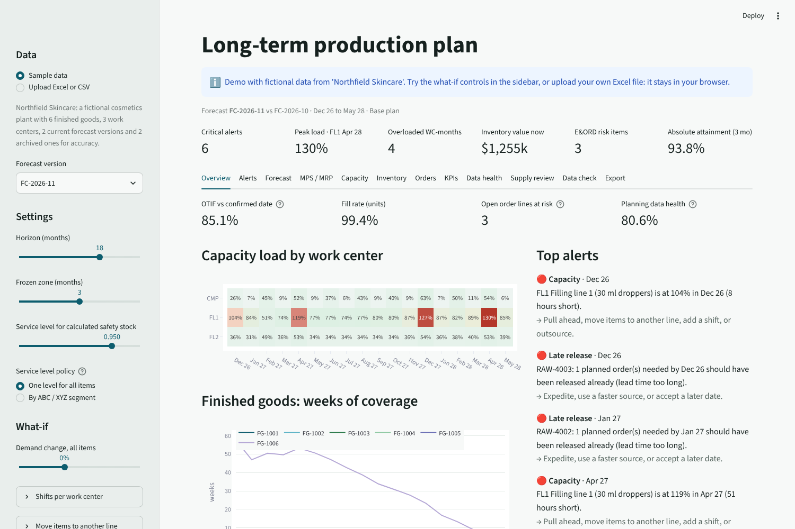

# LongRange Planner

Open-source long-term production planning for manufacturers: turn a monthly demand forecast into an
18-month master production schedule, check it against capacity and inventory targets, and get the alerts
and reports you need for S&OP.

It follows the same logic as the planning engines in ERP and MRP systems (Business Central, SAP, Dynamics 365
Supply Chain): forecast versions, MPS and MRP netting, lot sizing, safety stock, time fences, rough-cut capacity
and action messages. It runs on Excel or CSV data, so you can use it before, beside or instead of an ERP.



## What it does

| Area | What you get |
| --- | --- |
| Forecast | Load every monthly forecast version; compare versions (forecast bridge); statistical baseline from sales history (moving average, seasonal naive, damped Holt, Holt-Winters, picked by holdout error); accuracy (WMAPE) and bias by item |
| MPS / MRP | 18-month netting in monthly buckets: forecast consumed by sales orders, BOM explosion, lead-time offset, minimum order, order multiple, maximum order, lot accumulation, existing firm and released orders |
| Safety stock | Use your own values, or calculate Z × σ(forecast error) × √(lead time + 1 review month) from a service level |
| Time fences | Frozen and slushy zones: existing orders in the frozen zone are never changed, only flagged |
| Action messages | New planned orders, plus Cancel / Reduce suggestions for existing orders the new forecast no longer needs |
| Capacity | Hours required vs available per work center and month, with calendars, efficiency and setup time; breakdown by item |
| Inventory | Projected stock, weeks of coverage, inventory value, and E&O risk against shelf life |
| KPIs | Net attainment, absolute attainment, capacity utilization |
| Alerts | Shortages, below safety stock, late releases, capacity overloads, E&O risk, order changes, big forecast changes, attainment misses, data gaps; each with a suggested action |
| What-if | Demand up or down, shifts per work center, move items to another line, outsource items; the whole plan recalculates instantly |
| Reports | Excel workbook with every view, and a PDF S&OP supply review pack |

## Quick start

Requires Python 3.10 or newer.

```bash
git clone https://github.com/<your-account>/longrange-planner.git
cd longrange-planner
python -m venv .venv
source .venv/bin/activate          # Windows: .venv\Scripts\activate
pip install -e ".[dev]"

streamlit run app/streamlit_app.py
```

**On Windows**, you can instead double-click `install_windows.bat` once, then `run_planner.bat` whenever you
want to use it.

The dashboard opens in your browser with sample data from a fictional cosmetics plant. Switch to
**Upload Excel or CSV** in the sidebar to plan your own data.

### Put it online (Netlify or any static host)

The dashboard can also run with no server at all: [stlite](https://github.com/whitphx/stlite) runs Python and
Streamlit inside the visitor's browser, so uploaded files never leave their computer.

```bash
python scripts/build_site.py              # builds ./site
python -m http.server -d site 8000        # preview at http://localhost:8000
```

- **Netlify, drag and drop:** build, then drag the `site` folder onto [app.netlify.com/drop](https://app.netlify.com/drop).
- **Netlify from GitHub:** connect the repository; `netlify.toml` already sets the build command and the `site` folder.
- On Windows, `preview_site.bat` builds and opens the local preview.

The first visit takes 20 to 40 seconds while the browser downloads Python; later visits are faster.

### Command line

```bash
longrange template my_input.xlsx                  # blank input template with instructions
longrange sample samples/                         # sample data as .xlsx and CSV
longrange plan my_input.xlsx --out output/        # run the plan, write Excel and PDF reports
longrange plan samples/csv --version FC-2026-11   # a folder of CSVs works too
```

### Python

```python
from longrange import load_workbook, run_plan
from longrange.engine import Scenario
from longrange.reports import excel_report, pdf_report

data, issues = load_workbook("my_input.xlsx")
result = run_plan(data, scenario=Scenario(shifts={"FL1": 3}))
print(result.summary())
result.alerts.head(10)
open("plan.pdf", "wb").write(pdf_report(result))
```

## Input data

One workbook with a sheet per table, or one CSV per table. Only `items` and `forecast` are required;
each extra table adds a view. Run `longrange template` for a template with every column explained, and see
[docs/data-format.md](docs/data-format.md).

| Table | Purpose |
| --- | --- |
| `items` | Item master: type, make or buy, on hand, safety stock, lead time, lot sizing, shelf life, cost |
| `forecast` | Demand by version, item and month. Keep every monthly version |
| `bom` | Components per parent, with scrap % |
| `work_centers`, `calendar`, `routings` | Capacity, working days and run rates |
| `sales_history` | Actual sales, for the statistical forecast and accuracy |
| `sales_orders` | Open customer orders; they consume the forecast |
| `supply_orders` | Existing production and purchase orders |
| `production_actuals` | Planned vs actual output, for attainment |
| `settings` | Plan start, horizon, current forecast version, time fences, alert thresholds |

Common ERP export headers such as `No.`, `Quantity`, `Forecast Date` and `Replenishment System` are recognized.

## How the plan is calculated

See [docs/planning-logic.md](docs/planning-logic.md) for formulas and assumptions. In short:

1. **Demand:** independent demand per month is the larger of forecast and sales orders (forecast consumption).
2. **Netting:** items are planned top-down by BOM level. Projected available = previous + receipts − gross requirement.
   When it would fall below safety stock, a planned order is created and sized by the lot rules.
3. **Explosion:** each made item's orders create dependent demand for its components in the release month.
4. **Capacity:** planning assumes infinite capacity, as ERP planning worksheets do; the capacity check then
   shows where the plan is not feasible and which items drive it.
5. **Inventory and alerts:** coverage, value, E&O risk and alerts are calculated from the netted plan.

## Project layout

```
src/longrange/
  models.py            data model and schema (drives template, validation and docs)
  io/                  Excel / CSV import, template, connectors (Business Central stub)
  forecast/            statistical forecast, accuracy, version comparison
  planning/            netting (MPS/MRP), safety stock, capacity, inventory, KPIs, alerts
  engine.py            run_plan(): one call for the whole plan, with scenarios
  reports/             Excel and PDF reports
  cli.py               command line
app/streamlit_app.py   dashboard
tests/                 pytest suite
docs/                  data format, planning logic, roadmap
```

## Roadmap

ERP connectors (Business Central first, then SAP and others), finite-capacity levelling suggestions,
multi-site planning and saved scenarios. See [docs/roadmap.md](docs/roadmap.md).

## Contributing

Issues and pull requests are welcome. See [CONTRIBUTING.md](CONTRIBUTING.md).

## License

MIT. See [LICENSE](LICENSE).
